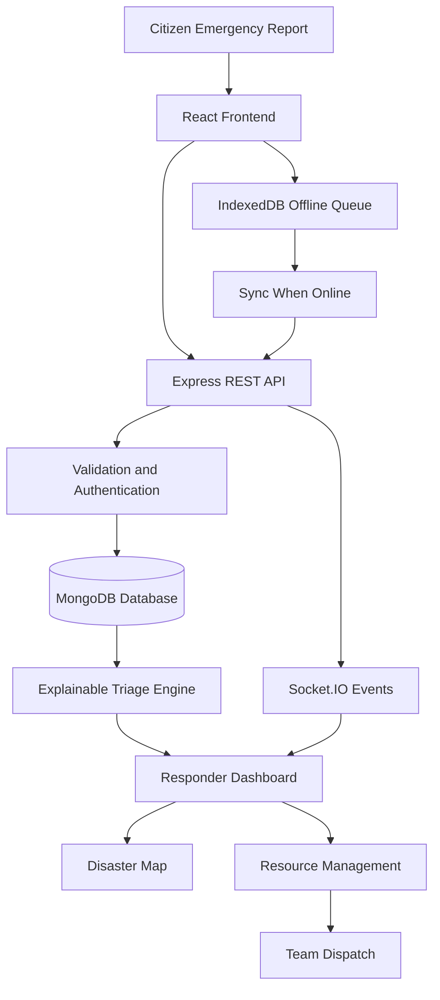
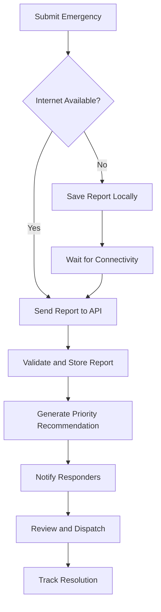

# ResQNet — Intelligent Disaster Response & Rescue Coordination

<p align="center">
  <strong>Finding Who Needs Help Most.</strong>
  <br />
  An explainable, resource-aware disaster response platform built to help responders prioritize emergencies, coordinate rescue teams, and reach vulnerable communities.
</p>

<p align="center">
  
  
  
  
</p>

---

## The Mission

When floods, heatwaves, and other disasters overwhelm communities, emergency responders must make difficult decisions with limited time, information, and resources.

**ResQNet helps answer one critical question: Who needs help most right now?**

The platform collects emergency reports, visualizes affected locations, provides explainable urgency recommendations, and supports coordinated rescue-team dispatch. It is designed to work with unreliable internet connectivity and to help responders make better-informed decisions.

> Technology should not simply show where a disaster is happening. It should help people understand where assistance is needed most.

## The Problem

Traditional disaster response can face several challenges:

- Emergency requests scattered across multiple communication channels.
- Difficulty identifying life-threatening situations quickly.
- Limited visibility into available rescue teams and supplies.
- Vulnerable people who may struggle to evacuate independently.
- Unreliable connectivity during floods and other emergencies.
- Limited transparency into why one emergency is prioritized over another.

## The Solution

ResQNet brings emergency reporting, triage, mapping, and resource coordination into one platform.

| Capability | What it does |
|---|---|
| Emergency reporting | Collects location, affected-person count, immediate dangers, injuries, and medical needs. |
| Explainable triage | Recommends case priorities and explains the factors behind each recommendation. |
| Disaster map | Displays reported emergencies and verified operational information geographically. |
| Resource management | Tracks rescue teams, vehicles, boats, medical supplies, and shelters. |
| Team dispatch | Helps authorized responders assign suitable teams to emergency cases. |
| Offline reporting | Queues reports locally and synchronizes them when connectivity returns. |
| Real-time coordination | Updates dashboards when reports or assignments change. |
| Audit trail | Records important decisions and changes for operational accountability. |

## Core Innovation — Explainable Emergency Triage

ResQNet is designed to prioritize reported needs using transparent, configurable rules rather than an unexplained score.

Potential factors include:

- **Immediate danger:** Is someone's life in immediate danger?
- **Medical urgency:** Are serious injuries or essential medical needs reported?
- **Evacuation difficulty:** Does someone require assistance to escape danger?
- **People affected:** How many people may need assistance?
- **Waiting time:** How long has the request remained unresolved?

Each recommendation should include:

1. A suggested priority level.
2. The specific factors that influenced the recommendation.
3. The current report status and relevant information.
4. A way for authorized responders to review and override the recommendation, with a recorded reason.

**Safety principle:** Triage recommendations support human decision-making; they do not replace trained emergency personnel. Missing information must not automatically be interpreted as evidence of low risk.

## System Architecture



## Technology Stack

### Frontend
- React
- Vite
- JavaScript
- Tailwind CSS
- React Router
- Leaflet / React Leaflet
- Socket.IO Client
- IndexedDB for offline storage

### Backend
- Node.js
- Express.js
- MongoDB
- Mongoose
- JSON Web Tokens (JWT)
- bcrypt
- Socket.IO

### Development and Deployment
- Git and GitHub
- Postman
- Vercel or another static frontend host
- Render or another Node.js-compatible backend host
- MongoDB Atlas or a local MongoDB instance

*These are the intended technologies; update this list to reflect the libraries and services actually implemented.*

## Project Structure

```text
ResQNet/
├── client/
│   ├── public/
│   └── src/
│       ├── components/
│       │   ├── common/
│       │   ├── dashboard/
│       │   ├── map/
│       │   └── reports/
│       ├── pages/
│       ├── features/
│       ├── hooks/
│       ├── services/
│       ├── offline/
│       ├── utils/
│       ├── App.jsx
│       └── main.jsx
├── server/
│   ├── src/
│   │   ├── config/
│   │   ├── models/
│   │   ├── controllers/
│   │   ├── routes/
│   │   ├── services/
│   │   ├── middleware/
│   │   ├── sockets/
│   │   ├── validators/
│   │   ├── seed/
│   │   └── server.js
│   └── tests/
├── docs/
├── .github/
│   └── workflows/
├── .gitignore
├── package.json
└── README.md
```

## Emergency Reporting Workflow



Reports should support GPS coordinates or manual location selection, the number of people affected, immediate dangers, medical needs, and available contact information. Duplicate detection and synchronization status should help operators distinguish pending reports from confirmed server records.

## Getting Started

### Prerequisites

Install the following before running the project:

- Node.js (an active LTS version)
- npm
- MongoDB locally or a MongoDB Atlas connection
- Git

### 1. Clone the Repository

```bash
git clone https://github.com/YOUR_USERNAME/ResQNet.git
cd ResQNet
```

Replace `YOUR_USERNAME/ResQNet` with your actual GitHub repository URL.

### 2. Install Dependencies

```bash
npm install
npm install --prefix client
npm install --prefix server
```

These commands assume the root, client, and server each have their own `package.json`.

### 3. Configure Environment Variables

Create `server/.env`:

```env
PORT=5000
NODE_ENV=development
MONGODB_URI=mongodb://127.0.0.1:27017/resqnet
JWT_SECRET=replace_with_a_long_random_secret
CLIENT_URL=http://localhost:5173
```

Create `client/.env`:

```env
VITE_API_URL=http://localhost:5000/api
```

Use your actual database connection string where necessary. Never commit `.env` files, production secrets, credentials, or real emergency-contact information to GitHub.

### 4. Start the Backend

```bash
npm run dev --prefix server
```

### 5. Start the Frontend

Open another terminal in the project root:

```bash
npm run dev --prefix client
```

Open the local URL displayed by Vite, usually `http://localhost:5173`.

**Note:** These commands require corresponding scripts to exist in each `package.json`. If your project uses different scripts or ports, adjust this section accordingly.

## Suggested API Endpoints

| Method | Endpoint | Purpose |
|---|---|---|
| POST | `/api/auth/register` | Register an account |
| POST | `/api/auth/login` | Authenticate a user |
| POST | `/api/reports` | Submit an emergency report |
| GET | `/api/reports` | Retrieve authorized reports |
| GET | `/api/reports/:id` | Retrieve an individual report |
| PATCH | `/api/reports/:id/status` | Update report status |
| GET | `/api/triage` | Retrieve priority recommendations |
| GET | `/api/teams` | List available rescue teams |
| POST | `/api/dispatches` | Create a team assignment |
| GET | `/api/resources` | View resource availability |
| GET | `/api/shelters` | View verified shelter information |

These are proposed endpoints, not a claim that they have already been implemented.

## User Roles

| Role | Responsibilities |
|---|---|
| Citizen | Submit emergency reports and view permitted submission status. |
| Responder | Review assigned cases, update statuses, and coordinate field operations. |
| Administrator | Manage users, rescue teams, resources, shelters, and dispatch decisions. |

Access to sensitive personal and operational information must be restricted according to role and operational need.

## Offline-First Design

Disasters can disrupt internet access and power infrastructure. ResQNet aims to:

- Store draft reports in IndexedDB.
- Queue submissions when the backend is unreachable.
- Retry synchronization when connectivity returns.
- Use unique report identifiers and idempotent server operations to reduce duplicates.
- Display clear pending, synchronized, and failed states.

Offline storage does not itself transmit reports. Reports remain pending until a working communication path becomes available. Users should be warned that locally stored reports may be lost if device storage is cleared or the device is damaged.

## Testing and Demo Scenario

Use simulated data only for the hackathon demonstration.

**Example: Urban flooding**

1. A citizen submits a report describing a flooded home with several occupants.
2. Another report describes a person with an urgent medical need.
3. The responder dashboard receives both reports.
4. ResQNet displays the relevant triage factors and suggested priorities.
5. An authorized responder reviews the cases and assigns an available rescue team.
6. The dashboard reflects the assignment and updated case status.
7. A third report is prepared offline and synchronized when the connection returns.

The demo should show that recommendations are explainable, reports are traceable, and final dispatch decisions remain under human control.

## Roadmap

- [ ] Stage 1 — Define requirements and project scope.
- [ ] Stage 2 — Build the React user interface.
- [ ] Stage 3 — Implement the backend and MongoDB models.
- [ ] Stage 4 — Implement emergency reporting.
- [ ] Stage 5 — Display reports on the disaster map.
- [ ] Stage 6 — Build explainable triage recommendations.
- [ ] Stage 7 — Implement resource management and dispatch.
- [ ] Stage 8 — Implement offline reporting and synchronization.
- [ ] Stage 9 — Add real-time updates, security, and audit logs.
- [ ] Stage 10 — Test, deploy, and prepare the hackathon presentation.

Mark each item complete only after the corresponding feature has been implemented and tested.

## Security and Responsible Use

- Validate incoming data on the server.
- Enforce role-based access controls.
- Protect authentication tokens and environment secrets.
- Limit access to contact details and sensitive locations.
- Keep an audit trail of important triage overrides and dispatch decisions.
- Label unverified reports and stale location data clearly.
- Use simulated emergency data during public demos.
- Do not represent the MVP as a certified emergency-dispatch system.

ResQNet is a prototype intended to support disaster-response coordination. It is not a replacement for official emergency services or trained rescue personnel.

## Contributing

Contributions, testing, accessibility improvements, documentation, and responsible feature suggestions are welcome.

1. Fork the repository.
2. Create a feature branch.
3. Implement and test your changes.
4. Submit a pull request describing the change.

## License

This project is released under the MIT License, unless another license is selected in the repository. Add a corresponding `LICENSE` file before claiming that the project is officially licensed.

---

<p align="center">
  <strong>ResQNet</strong>
  <br />
  Prioritize needs. Coordinate resources. Help communities recover.
</p>
