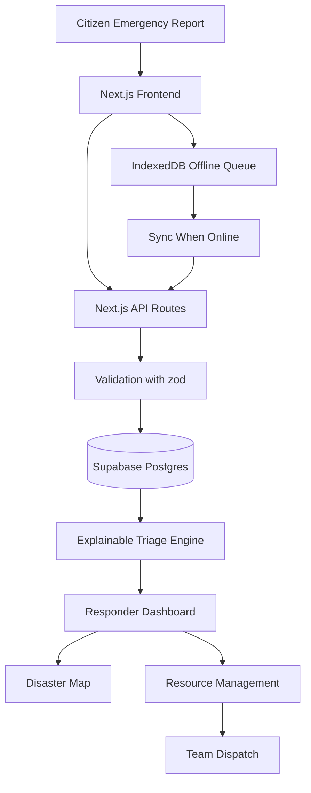
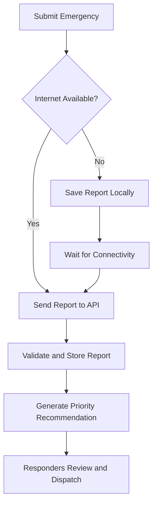

<h1 align="center">VYRA</h1>

<p align="center">
  <strong>Vulnerability, Yielded Response &amp; Assistance</strong>
  <br />
  <em>Finding who needs help most.</em>
</p>

<p align="center">
  An explainable, resource-aware disaster response platform that helps responders prioritize emergencies, coordinate rescue teams, and reach vulnerable communities, even when connectivity is unreliable.
</p>

<p align="center">
  
  
  
  
</p>

---

## Table of Contents

- [The Mission](#the-mission)
- [Features](#features)
- [Explainable Triage](#explainable-triage)
- [Architecture](#architecture)
- [Tech Stack](#tech-stack)
- [Getting Started](#getting-started)
- [Environment Variables](#environment-variables)
- [Demo Accounts and Data](#demo-accounts-and-data)
- [Pages](#pages)
- [API Reference](#api-reference)
- [User Roles](#user-roles)
- [Offline-First Reporting](#offline-first-reporting)
- [Project Structure](#project-structure)
- [Scripts](#scripts)
- [Testing](#testing)
- [Deployment](#deployment)
- [Contributing](#contributing)
- [Security and Responsible Use](#security-and-responsible-use)
- [Roadmap](#roadmap)
- [License](#license)

---

## The Mission

When floods, heatwaves, and other disasters overwhelm communities, responders must make hard decisions with limited time, information, and resources.

VYRA answers one question: **who needs help most right now?**

It collects emergency reports, shows them on a map, recommends priorities with a plain-language explanation, and supports dispatching rescue teams, all designed to keep working when the internet does not.

> Technology should not simply show where a disaster is happening. It should help people understand where assistance is needed most.

## Features

| Capability | What it does |
|---|---|
| **Emergency reporting** | Citizens report location, people affected, dangers, injuries, medical needs, and contact details. No account is required. |
| **Explainable triage** | Every report gets a priority level (Critical, High, Medium, Low) and a list of the exact factors behind it. |
| **Responder dashboard** | A ranked triage queue with case detail, verification, status tracking, and priority override with a recorded reason. |
| **Disaster map** | Leaflet map of cases, verified shelters, rescue teams, and blocked roads, with filters. |
| **Resource management** | Rescue teams, supplies (boats, vehicles, first aid, medical, food, water), and shelters. |
| **Team matching and dispatch** | Suggests suitable teams and supplies for a case, and tracks missions through to completion. |
| **Offline reporting** | Reports are queued in IndexedDB and synchronized when connectivity returns. |
| **Audit trail** | Status changes, verification, and priority overrides are recorded as append-only history. |
| **Admin accounts** | Administrators can create citizen, responder, and admin accounts from the website. |
| **Demo mode** | The whole app runs on in-memory simulated data with no database or sign-up. |

## Explainable Triage

VYRA scores reports with transparent, configurable rules instead of an opaque model. The rules live in [`src/lib/triageRules.ts`](src/lib/triageRules.ts), and every number appears in the explanation a responder sees.

Factors considered:

- **Immediate danger:** drowning, trapped, collapse, fire, rising water, electrocution, gas leak, and more.
- **Injuries and medical need:** severity, number injured, life-sustaining needs (dialysis, oxygen, insulin, and so on).
- **Evacuation difficulty and vulnerability:** people who cannot leave unaided, plus elderly, infants, disability, pregnancy.
- **People affected:** banded by group size.
- **Waiting time:** points accrue the longer an open request waits.
- **Free-text cues:** phrases such as "not breathing" or "trapped", always labelled as text-derived.

| Level | Score threshold |
|---|---|
| Critical | 70 and above |
| High | 45 to 69 |
| Medium | 20 to 44 |
| Low | below 20 |

**Safety principles**

- Recommendations support human decisions; they do not replace trained emergency personnel.
- **Missing information is never treated as low risk.** Unknown key fields add points, raise a "verify" flag, and can set a Medium floor.
- Authorized responders can override any recommendation, and the reason is recorded.

## Architecture



The data layer is swappable: the same API routes run against Supabase (`supabaseStore.ts`) or an in-memory store (`memoryStore.ts`) depending on configuration.

## Tech Stack

- **App:** Next.js 14 (App Router), React 18, TypeScript, Tailwind CSS
- **Data and auth:** Supabase (Postgres, Auth) via `@supabase/supabase-js`
- **Maps:** Leaflet and React Leaflet
- **Validation:** zod
- **Offline:** IndexedDB queue and a service worker
- **Tests:** `tsx --test`
- **Hosting:** Vercel (app) and Supabase cloud (database)

## Getting Started

**Requirements:** Node.js 18 or newer, and npm.

### Option 1: Try it with no setup (demo mode)

```bash
npm install
npm run dev:demo
```

Open <http://localhost:3000>. Data is simulated and held in memory, and the sign-in page lists the demo accounts.

### Option 2: Run against your own Supabase cloud project

```bash
npm install
cp .env.example .env.local        # Windows PowerShell: copy .env.example .env.local
```

1. Create a project at <https://supabase.com> and note the database password.
2. In **Project Settings → API Keys**, copy the **Project URL** and **Publishable key**.
3. Fill in `.env.local` (see [Environment Variables](#environment-variables)).
4. Create the tables and load the demo data:

   ```bash
   npm run db:setup -- --seed
   ```

5. Start the app:

   ```bash
   npm run dev
   ```

6. Verify the connection: `curl http://localhost:3000/api/demo/auth` should return `{"demo":false}`.

Prefer the SQL Editor? Paste `supabase/vyra_complete_schema.sql`, then `supabase/migrations/001_stage7_8_dispatch_offline.sql`, then `supabase/seed/vyra_full_seed.sql`. The full walkthrough, including Supabase auth settings and troubleshooting, is in **[SETUP_GUIDE.md](SETUP_GUIDE.md)**.

## Environment Variables

Copy `.env.example` to `.env.local`. Never commit `.env.local`.

| Variable | Required | Purpose |
|---|---|---|
| `NEXT_PUBLIC_SUPABASE_URL` | Yes (cloud) | Supabase project URL |
| `NEXT_PUBLIC_SUPABASE_PUBLISHABLE_KEY` | Yes (cloud) | Publishable key (the older `anon` key also works) |
| `SUPABASE_SERVICE_ROLE_KEY` | Optional | **Server only.** Lets admins create pre-confirmed accounts. Never prefix with `NEXT_PUBLIC_`. |
| `DATABASE_URL` | Local setup only | Session pooler connection string for `db:setup` and `db:seed`. Do not add it to Vercel. |
| `SEED_PASSWORD` | Local setup only | Password given to all seeded demo accounts (default `VYRA-demo-1`) |
| `VYRA_DATA_MODE` | Optional | Set to `demo` to force in-memory mode |

## Demo Accounts and Data

The seed loads a fictional urban-flooding scenario across ten Karachi areas:

| Data | Count |
|---|---|
| Accounts | 30 (1 administrator, 9 responders, 20 citizens) |
| Emergency cases | 30, covering every urgency level and status |
| Rescue teams, supplies, shelters | 30 each |
| Route hazards and blocked roads | 30 each |
| Missions | 30 (8 live, 16 completed, 6 cancelled) |

Sample sign-ins (password is your `SEED_PASSWORD`, or `VYRA-demo-1`):

| Role | Email |
|---|---|
| Administrator | `admin@demo.vyra` |
| Responder | `dispatcher@demo.vyra`, `fieldlead@demo.vyra`, `logistics@demo.vyra` |
| Citizen | `citizen@demo.vyra`, `neighbour@demo.vyra` |

Run `npm run db:seed` at any time to reset the demo data. Details are in [DEMO_DATA.md](DEMO_DATA.md).

## Pages

| Route | Description |
|---|---|
| `/` | Home and live incident preview |
| `/report` | Submit an emergency report (no sign-in needed, works offline) |
| `/report/[id]` | Case detail and public status for the reporter |
| `/dashboard` | Responder triage queue and case detail |
| `/map` | Disaster map with cases, shelters, teams, and blocked roads |
| `/dispatches` | Missions and team assignments |
| `/resources` | Teams, supplies, and shelters |
| `/admin/users` | Create and list accounts (administrators only) |
| `/auth/login`, `/auth/register` | Sign in and sign up |

## API Reference

| Method | Endpoint | Purpose |
|---|---|---|
| POST, GET | `/api/reports` | Submit or list reports |
| GET, PATCH | `/api/reports/:id` | Retrieve or update a report |
| PATCH | `/api/reports/:id/status` | Update status |
| PATCH | `/api/reports/:id/verify` | Verify a report |
| PATCH | `/api/reports/:id/triage-override` | Override priority with a recorded reason |
| GET | `/api/reports/:id/matches` | Suggested teams and supplies |
| GET | `/api/reports/:id/public-status` | Reference number and status for the reporter |
| GET | `/api/triage`, `/api/triage/rules` | Priority queue and rules |
| GET | `/api/map/layers` | Verified shelters, teams, and blocked roads |
| GET, POST | `/api/teams`, PATCH, DELETE `/api/teams/:id` | Rescue teams |
| GET, POST | `/api/resources`, PATCH, DELETE `/api/resources/:id` | Supplies |
| GET, POST | `/api/shelters` | Shelters |
| GET, POST | `/api/hazards`, PATCH, DELETE `/api/hazards/:id` | Route hazards |
| GET, POST | `/api/dispatches`, PATCH `/api/dispatches/:id` | Missions |
| GET, POST | `/api/admin/users` | Admin account management |
| GET | `/api/demo/auth` | Reports whether the app is in demo mode |

## User Roles

| Role | Responsibilities |
|---|---|
| **Citizen** | Submit reports and view the status of their submissions |
| **Responder** | Review cases, update statuses, and coordinate field operations |
| **Administrator** | Manage accounts, teams, resources, shelters, and dispatch decisions |

> **Note:** At present a role decides where a user lands after sign-in and which admin features appear. Server-side role enforcement and tighter database policies are still on the roadmap (see [Security](#security-and-responsible-use)).

To promote your own account, register normally and then run in the Supabase SQL Editor:

```sql
UPDATE profiles SET role = 'admin' WHERE email = 'you@example.com';
```

## Offline-First Reporting



- Draft reports are stored in IndexedDB and submissions are queued when the backend is unreachable.
- Sync retries when connectivity returns, using unique report identifiers to reduce duplicates.
- The UI shows clear pending, synchronized, and failed states.

Offline storage does not transmit anything by itself. Reports stay pending until a connection exists, and they can be lost if device storage is cleared or the device is damaged.

## Project Structure

```text
VYRA/
├── src/
│   ├── app/              # Pages and API routes (App Router)
│   ├── components/       # UI grouped by feature (map, dashboard, reports, ...)
│   ├── hooks/            # useOfflineSync
│   └── lib/              # triage, matching, dispatch, offline queue, stores, demo data
├── supabase/
│   ├── vyra_complete_schema.sql    # Tables, indexes, triggers, security rules
│   ├── vyra_complete_setup.sql     # Schema + migration + seed in one file
│   ├── migrations/
│   └── seed/vyra_full_seed.sql     # Demo accounts and simulated data
├── scripts/              # db:setup, db:seed, seed generators
├── public/sw.js          # Service worker
├── tests/                # triage, API, ops, admin tests
├── SETUP_GUIDE.md        # Cloud Supabase setup, step by step
├── DEMO_DATA.md          # What the demo data contains
└── PROJECT_PLAN.md       # Original scope and schema plan
```

## Scripts

| Command | What it does |
|---|---|
| `npm run dev` | Start the app against your Supabase project |
| `npm run dev:demo` | Start with in-memory demo data |
| `npm run build` / `npm start` | Production build and server |
| `npm run lint` | Run ESLint |
| `npm test` | Run the triage, API, ops, and admin tests |
| `npm run db:setup` | Create or update the tables |
| `npm run db:setup -- --seed` | Tables plus the full demo seed |
| `npm run db:seed` | Reset the demo data and accounts only |
| `npm run db:seed:generate` | Rebuild the seed SQL after editing the demo data files |

## Testing

```bash
npm test
```

Tests cover the triage engine, API routes, dispatch and operations logic, and admin account handling. Run `npm run build` before opening a pull request to catch type and lint errors.

**Example demo scenario (urban flooding):**

1. A citizen reports a flooded home with several occupants.
2. A second report describes a person with an urgent medical need.
3. The dashboard ranks both and shows the factors behind each priority.
4. A responder reviews the cases and assigns an available rescue team.
5. The dashboard reflects the assignment and the new status.
6. A third report, prepared offline, syncs when the connection returns.

## Deployment

VYRA deploys to **Vercel** with **Supabase cloud** as the database.

1. Push the repository to GitHub, and develop on feature branches merged through pull requests.
2. In Vercel choose **Add New → Project**, import the repository, and keep the detected Next.js settings.
3. Add `NEXT_PUBLIC_SUPABASE_URL` and `NEXT_PUBLIC_SUPABASE_PUBLISHABLE_KEY` (and optionally `SUPABASE_SERVICE_ROLE_KEY`) as environment variables. Do **not** add `DATABASE_URL` or `SEED_PASSWORD`.
4. Deploy, then in Supabase set **Authentication → URL Configuration → Site URL** to your Vercel address and add it to the Redirect URLs.
5. Every pull request now gets a preview deployment, and every merge to `main` deploys to production.

## Contributing

1. Fork the repository.
2. Create a branch: `git switch -c feature/your-change`
3. Make and test your changes (`npm test`, `npm run build`).
4. Confirm no secrets or `.env` files are staged.
5. Push the branch and open a pull request describing what changed and how you tested it.

Contributions of all kinds are welcome: testing, accessibility, documentation, and responsible feature suggestions.

## Security and Responsible Use

VYRA is a **prototype**. It is not a certified emergency-dispatch system and does not replace official emergency services or trained rescue personnel.

**Known limitations to resolve before real emergency data is stored:**

- Row Level Security policies in `vyra_complete_schema.sql` are permissive: any request made with the publishable key can read and change every table, including `profiles.role`.
- Roles are not yet enforced in pages or API routes.
- Seeded demo accounts share a password that is public in this repository unless you set `SEED_PASSWORD`.

**Good practice**

- Use simulated data for public demos.
- Never commit `.env.local`, keys, or real contact details.
- Keep `SUPABASE_SERVICE_ROLE_KEY` on the server only.
- Restrict access to contact details and sensitive locations by role.
- Label unverified reports and stale location data clearly.

## Roadmap

- [x] Stage 1: Requirements and scope
- [x] Stage 2: User interface
- [x] Stage 3: Backend and database models
- [x] Stage 4: Emergency reporting
- [x] Stage 5: Disaster map
- [x] Stage 6: Explainable triage
- [x] Stage 7: Resource management and dispatch
- [x] Stage 8: Offline reporting and synchronization
- [ ] Stage 9: Real-time updates (currently polling), role enforcement, tightened database policies
- [ ] Stage 10: Final testing, deployment hardening, and presentation

## License

No license file is included yet. Add a `LICENSE` file (for example MIT) before distributing or accepting outside contributions.

---

<p align="center">
  <strong>VYRA</strong>
  <br />
  Prioritize needs. Coordinate resources. Help communities recover.
</p>
